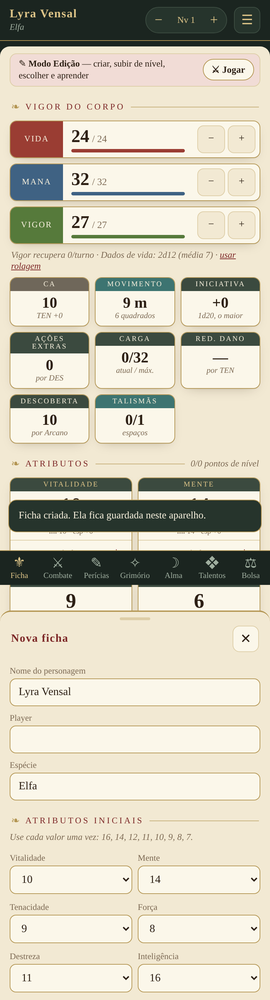
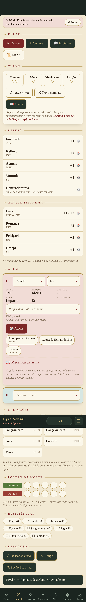
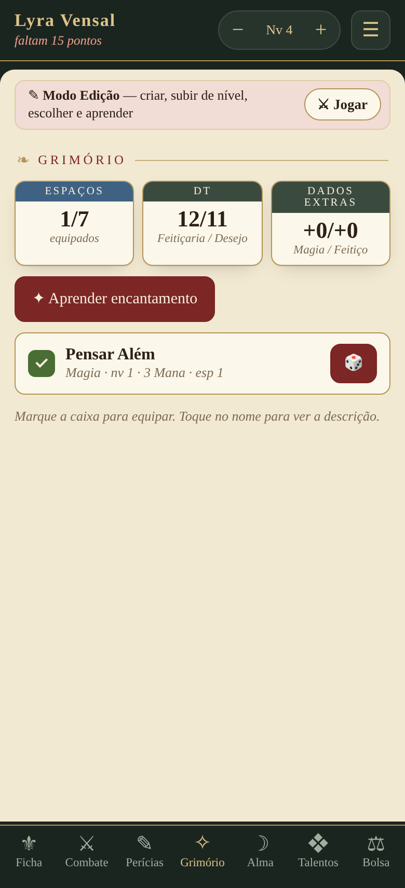
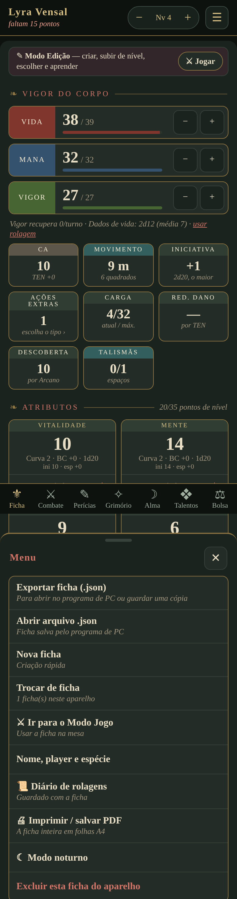

# Ficha Prevalecentes 3.1

Ficha de personagem automatizada para o RPG **Prevalecentes (PREVA 3.1)**, para PC (Windows) e celular (app instalável, funciona offline), com **sessão de mesa**: o mestre vê Vida, Mana e Vigor dos jogadores em tempo real e envia dano, condições, efeitos e itens.

<p align="center">
  
  
  
  
</p>

## Índice

- [Começando](#começando)
- [Funcionalidades](#funcionalidades)
- [Sessão de mesa](#sessão-de-mesa)
- [App de celular](#app-de-celular)
- [Desenvolvimento](#desenvolvimento)
- [Dados do livro e fichas salvas](#dados-do-livro-e-fichas-salvas)
- [Estrutura do projeto](#estrutura-do-projeto)

## Começando

| Quero usar… | Como |
|---|---|
| **No PC (Windows)** | Abra `FichaPrevalecentes.exe`. Não requer Python. |
| **No celular** | Abra <https://grnguidi.github.io/FichaPreval/> no Chrome e toque em ⋮ → "Instalar app". |
| **Pelo código-fonte** | Instale o Python 3 e rode os comandos abaixo. |

```
py -m pip install reportlab segno
py prevalecentes.py
```

Para **gerar o executável**, execute `GERAR_EXE.bat` (requer Python no PATH). Ele instala PyInstaller, reportlab e segno, compila o programa e substitui `FichaPrevalecentes.exe` na pasta.

## Funcionalidades

As fórmulas usadas estão em **Ajuda > Regras usadas nos cálculos**.

### Ficha e cálculos

- Cálculo automático de Curva, Bônus de Combate, Vida, Mana, Vigor, CA, Carga, Movimento, Iniciativa, ações extras, Redução de Dano, Resistências, Descoberta, perícias, ataques, defesas e DTs.
- Pontos de atributo por nível, com painel de avisos para pendências.
- Assistente de criação de personagem, seguindo o capítulo "Criando seu Personagem" (o personagem novo entra no nível do grupo, com Caminho da Meta de Vida). No celular, o mesmo passo a passo.
- **Metas de Vida:** os 9 Caminhos do livro, com as 3 etapas em ordem e o mentor. Cada Meta concluída abre um slot de talento (M1–M5); a primeira dá +5 pontos de atributo.
- Clicar no nome de uma **perícia** mostra o que ela faz, o atributo, se exige treino e onde o livro a usa. Clicar no nome de um **atributo** mostra o que o valor atual dá na ficha. No celular, toque no nome (perícia: no Modo Edição).
- **Modo Edição e Modo Jogo.** Criar, subir de nível e escolher talentos, armas, encantamentos e equipamento só no Modo Edição (ficha nova abre nele). No Modo Jogo, usado na mesa, essas escolhas ficam travadas, e continuam liberados Vida/Mana/Vigor, rolagens, condições, Portão da Morte, inventário e anotações. Fichas abertas do disco começam no Modo Jogo.
- Comparação entre duas fichas.
- Temas diurno, noturno e **Vitral** (creme, dourado e verde musgo, com vinhas e vitrais).
- Exportação da ficha em PDF no visual Vitral, com as características de espécie (ajustes de atributo e par descritivo).

### Equipamento e build

- Menus de armas, encantamentos, talentos, armaduras, escudos, talismãs e sets, indicando o que está disponível e o motivo de cada restrição.
- **Propriedades de armas:** as 16 propriedades do livro, com o limite da arma (tabela do nível + Domínio). Os efeitos entram sozinhos (Afiada, Cruel e Poderosa no dano; Pesada sobe o dado e dobra a Força exigida; Certeira e Destruidora no crítico; Equilibrada no ataque; Elemental/Sagrada/Profana rolam o 1d6 extra; Reforçada aumenta o desgaste para 4; Voraz cura no crítico; Discreta dá +5 em Furtividade).
- **Talentos com escolha** (Maestria, Maestria dupla, Domínio, Matrícula, Matrícula avançada, Condição Endurecida, Mestre das Perícias): você escolhe a arma, a escola, a condição ou a perícia, e o efeito vale só para ela.
- **Encantamentos** com dados de condição já escalados pelo Arcano (cópias a cada 20, dados inferiores a cada 15), com Mente Arcana (+10 de Arcano) e Senhor das Condições (+1 cópia).
- **Sets** que aplicam pontos de condição (Sangria, Peçonha, Miasma, Geada, Delírio, Torpor, Gume) mostram os pontos em cada acerto ou crítico, com valor fixo (os números dos sets não escalam com o Arcano, como diz o livro).
- **Alma:** montador de habilidades pela Tabela de valores do livro (categorias, ajustes, execução), com valor e DT calculados; "Usar e rolar" gasta um uso e rola o dano.
- **Inventário** com a lista de Itens Diversos do livro (peso preenchido), quantidade e botão de usar consumíveis. A Mochila soma +5 de Carga; peças de set pesam 1.
- **Dinheiro** em Contos, prata, ouro e Contilha, com conversão e compra de itens do livro.

### Combate

- **Rolagens** de ataque, conjuração e perícias (1d20 a mais a cada 20 pontos do atributo, fica o maior), com consumo de Vigor e Mana. O diário guarda as 100 mais recentes na ficha.
- **Turno:** Comum, Bônus, Movimento e Reação mais as ações extras da Destreza. Ataques, encantamentos, itens e habilidades da Alma marcam a ação sozinhos e avisam quando não sobrava. Na sessão, o turno renova quando o mestre passa a vez e o combate quando ele rola a iniciativa ou o encerra.
- **Ações do livro** (Agarrar, Derrubar, Esconder, Provocar, Golpe de Oportunidade…) com a rolagem certa.
- **Ações das armas** como botões: "Usar" marca a ação do turno e "Rolar" ataca com os ajustes lidos do texto (níveis de dano, vantagem/desvantagem, crítico garantido, multiplicador, teste do alvo com a DT). Ações de vários disparos (Chuva de Flechas, Rajada Tripla, Combustão…) rolam cada disparo e descontam a munição. Há contadores da mecânica de cada arma (Momentum, Cartuchos, Flechas, Melodias…).
- **Defesas e Contradomínio:** rolar Fortitude, Reflexo, Vontade e Astúcia; Contradomínio com limite por combate (+2 com Contra-encantador); Coordenação do Uso duplo contra DT 8 + maior nível de arma.
- **Desgaste de armas:** 3 turnos afiados, o crítico reafia; a arma desgastada fica um turno parada.
- **Usos limitados:** talentos e talismãs "1x por combate/descanso" e os usos da Alma, recarregados no turno, no fim do combate e nos descansos.
- Descanso curto e longo (Vida, Mana, Vigor e barras de condição) e Poção Espiritual.

## Sessão de mesa

Liga o mestre aos jogadores. Existe uma única sessão por rede.

### Mestre

Abra **Sessão → "Entrar como mestre"**. O painel tem:

- **Cartão por jogador:** personagem, barras de Vida, Mana e Vigor, nível, CA, movimento, iniciativa, Portão da Morte, condições e se está no celular ou sem sinal. Atualiza sozinho.
- **Dano / Cura:** valor, tipo de dano do livro e descrição. A ficha do jogador desconta a RD e as resistências dele (Magia Pura e Relâmpago ignoram RD; "Direto" ignora tudo). Dá para marcar vários jogadores.
- **Efeito:** um dos efeitos do livro (Abalado, Caído, Exposto, Fragilizado, Paralisado…) com duração em turnos (0 = até o mestre remover). Fragilizado tira a RD e as resistências do dano recebido.
- **Condição:** pontos de Veneno, Podridão, Sangramento, Congelamento, Sono, Loucura ou Morte com a DT do inimigo. A ficha rola Fortitude ou Vontade, recebe metade num sucesso e, se a barra de 100 encher, aplica o efeito do livro.
- **Bolsa:** o mestre vê inventário, carga e dinheiro de cada jogador, dá e tira itens (do livro ou personalizados). O jogador é avisado.
- **Turnos:** "🎲 Iniciativa" rola a de todos e monta a ordem; "Passar turno ▶" avisa o jogador da vez e, depois do último, começa a rodada seguinte. As durações contam no fim do turno do afetado, e Veneno e Podridão tiram Vida no começo do turno. "Fim do combate" limpa a ordem e os efeitos de combate.
- **Mãos levantadas:** fila com "Dar a palavra", mais o registro do que o mestre enviou e dos jogadores rolaram.

### Jogador

- **No computador:** abra a ficha, depois **Sessão → "Entrar como jogador"**. O programa localiza o mestre; se não achar, informe o IP exibido na tela do mestre.
- **No celular:** aponte a câmera para o QR code da tela do mestre ou abra o endereço mostrado (`http://IP:5760`). Informe seu nome, abra ou crie a ficha e jogue. Não requer instalação nem internet. (A página antiga, só com o botão de mão, continua em `http://IP:5760/mao`.)

### Levar a ficha do app para a mesa (e de volta)

O jogador mantém a ficha no app instalado (GitHub Pages). Como um site `https` não pode enviar dados a `http://IP`, a ficha viaja no endereço (trecho `#f=` da URL, comprimido, lido só pelo navegador), sem servidor no meio.

- **App → mesa:** na página do mestre, toque em **📲 Trazer minha ficha do app** e, no app, em **Enviar** na ficha escolhida. Ela substitui a de mesmo nome. Também dá para usar **🛡 Entrar na mesa do mestre** no app, digitando o endereço.
- **Mesa → app:** no menu da página do mestre, **📲 Levar esta ficha de volta ao app** (o botão também aparece no aviso de fim de combate). A ficha de mesmo nome no app é substituída pela atual.
- Durante a sessão, a ficha da mesa recebe dano, cura, condições e itens; o app instalado só é atualizado por esse botão.
- O app instalado e a página da mesa guardam fichas em lugares separados. No iPhone, o app da Tela de Início e o Safari também têm armazenamento separado, então o app mostra o botão **⬇ Backup de todas as fichas** (um `.json`; "Abrir arquivo .json" restaura). Recomenda-se usar o app direto pelo Safari e fazer backup de vez em quando.

### Jogar de longe (internet)

Botão **🌐 Convidar** na mesa do mestre.

- **Mesa pela internet:** "Abrir a mesa para a internet" cria um link (túnel da Cloudflare, sem conta e sem mexer no roteador). No celular, é só abrir o link; no PC, o jogador cola o link em "link ou IP do mestre". Na primeira vez o programa pede para baixar o `cloudflared` (~65 MB) para `~/.prevalecentes`; se preferir, deixe `cloudflared.exe` ao lado do programa. O link muda a cada sessão.
- **Senha da mesa:** opcional na rede local, criada sozinha ao abrir para a internet (o link já a leva). Após 20 tentativas erradas em um minuto, a entrada trava por um minuto.
- **Chave por aparelho:** cada celular ou PC por link recebe uma chave ao entrar; sem ela ninguém lê nem age em nome de outro jogador.
- **Atualização na hora:** dano e vez chegam em menos de um segundo.
- **Reconexão automática:** o PC volta sozinho, com o mesmo nome, quando a conexão cai.
- **Mesa guardada:** rodada, ordem de turno, efeitos, fichas e eventos pendentes ficam em `~/.prevalecentes/sessao.json`. Se o PC do mestre fechar, ao entrar de novo (em até 12 horas) o programa oferece retomar.

### Grupo: interação entre os jogadores

Botão **👥 Grupo** no PC e aba **Grupo** no celular, durante a sessão.

- **Painel do grupo:** nome, barra de Vida, condições e de quem é a vez. Cada jogador escolhe o que mostra (tudo, só a barra ou nada).
- **Ajuda pelas regras:** Medicina no Portão da Morte (DT 15), Incentivar (Reação), curas e efeitos com alvo, refeição com Gastronomia (DT 10/20/30/40).
- **Trocas:** dar item ou dinheiro, espólio liberado pelo mestre (quem quer marca; empate no d20) e caixa do grupo com registro.
- **Rolagens:** feed com as rolagens de todos, reações rápidas e teste em grupo pedido pelo mestre.
- **Combinar o turno:** sinais, intenção para o próximo turno e sussurro entre dois jogadores (o mestre vê só o aviso, o texto inteiro, ou desliga).
- **Fora do combate:** vínculos entre dois personagens e diário do grupo.
- Tudo que muda a ficha de outro jogador vira um pedido, válido quando o destinatário (ou o mestre) aceita. O aceite automático vale só para ajudas; trocas sempre perguntam.
- O mestre liga e desliga cada recurso. Caixa, diário e vínculos ficam em `~/.prevalecentes/grupo.json`.

### Rede, segurança e comportamento

- **Firewall:** na primeira execução como mestre, o Windows pede permissão. Permita o acesso em redes privadas.
- **Portas:** 5757 (TCP), 5758 (UDP) e 5760 (HTTP).
- **Redes com isolamento** de dispositivos (Wi-Fi de visitantes, hotéis, escolas) impedem a conexão.
- **Sem senha na rede local:** qualquer pessoa na mesma rede que conheça o endereço pode entrar. Use a senha da mesa se precisar.
- **Papéis:** o programa não distingue mestre de jogador; apenas quem usa o botão de mestre recebe os avisos. Combinem que só o mestre o utilize.
- **O que o mestre recebe:** só o resumo da ficha (nome, espécie, nível, Vida, Mana, Vigor, CA, movimento, iniciativa, defesas, RD, resistências, Portão da Morte, barras de condição, inventário, carga e dinheiro), a cada ~1,5 s. Ele não edita a ficha do jogador: envia dano, cura, condições e itens.
- **Entrega confiável:** os eventos do mestre são repetidos até o celular confirmar, então não se perdem se a tela bloquear ou o Wi-Fi cair.
- **Tela bloqueada:** o mestre vê "(sem sinal)" ao lado do nome após 20 s e a mão continua na fila. Após 10 min sem contato, o jogador sai da mesa e perde também a vez na iniciativa, os efeitos e o resumo.
- **Conexão perdida:** o jogador no PC vê o aviso e um botão para reconectar. Se o mestre não for encontrado, o programa sugere o último IP usado.

## App de celular

Ficha de mesa para o celular: Vida, Mana e Vigor, atributos, características, perícias, armas com ações, rolagens, grimório, talentos e bolsa. Tem as mesmas funções de mesa do PC (turno, usos, Alma, Metas de Vida, dinheiro, diário, Modo Jogo/Edição) e "🖨 Imprimir / salvar PDF" no menu. Abre os mesmos arquivos `.json` do PC e funciona sem internet depois de instalado.

- **Instalar no Android:** <https://grnguidi.github.io/FichaPreval/> no Chrome → ⋮ → "Instalar app" (ou "Adicionar à tela inicial").
- **PC → celular:** "Abrir arquivo .json" carrega uma ficha salva pelo PC. As fichas ficam guardadas no aparelho.
- **Celular → PC:** menu ☰ → Exportar ficha (.json). A ficha vai e volta sem perder nada.

## Desenvolvimento

**App de celular:** o código está em `celular/src/js/`, em arquivos numerados por área (armazenamento, cálculo, telas, ações, mesa, rolagens, menu, sessão, eventos). O `celular/build.py` junta todos no mesmo escopo, na ordem do nome. Depois de mudar algo, rode:

```
py celular/build.py
```

Isso gera a pasta `docs/` (publicada pelo GitHub Pages) e o `pagina_celular.py` (a mesma ficha, servida pelo PC do mestre). Os dados do livro e a tabela de efeitos de talento vêm de `dados_prevalecentes.py` e `regras.py`, então PC e celular continuam iguais.

**Testes:**

```
sh celular/testes/rodar.sh        # regras do celular iguais às do PC (requer Node.js)
python testes/test_sessao.py      # entrega e confirmação de eventos, limpeza de quem sai
python testes/test_grupo.py       # interação entre jogadores
python testes/test_conexao.py     # conexão
```

## Dados do livro e fichas salvas

- **Dados do livro:** armas, encantamentos e talentos estão embutidos (`dados_prevalecentes.py`). Para corrigir algum, edite uma cópia de `dados_livro (para editar).json`, renomeie para `dados_prevalecentes.json` e coloque ao lado do executável; ele passa a ser usado no lugar dos dados embutidos.
- **Fichas:** salvas manualmente em `.json` (Ctrl+S) e abertas com Ctrl+O. O programa não reabre a última ficha automaticamente.

## Estrutura do projeto

| Arquivo | Descrição |
|---|---|
| `prevalecentes.py` | Programa principal e interface |
| `regras.py` | Cálculos das regras, sem interface |
| `regras_texto.py` | Texto da janela "Regras usadas nos cálculos" |
| `assistente.py` | Assistente de criação de personagem |
| `pdf_ficha.py` | Exportação para PDF |
| `sessao.py` | Sessão em rede e painel do mestre |
| `ponte_sessao.py` | Liga a ficha do PC aberta à sessão (resumo e eventos do mestre) |
| `grupo.py`, `grupo_ui.py` | Interação entre jogadores (servidor e janelas) |
| `tunel.py` | Mesa pela internet (túnel com o cloudflared) |
| `pagina_celular.py` | Ficha do celular servida pelo mestre (gerado por `celular/build.py`) |
| `dados_prevalecentes.py` | Dados do livro embutidos |
| `dados_livro (para editar).json` | Cópia editável dos dados do livro |
| `GERAR_EXE.bat` | Gera o executável |
| `celular/` | Código do app de celular (`src/js/` e `build.py`) |
| `docs/` | App de celular pronto, publicado pelo GitHub Pages |
| `testes/` | Testes de sessão, grupo e conexão |
| `s*.png` | Capturas de tela usadas neste README |
